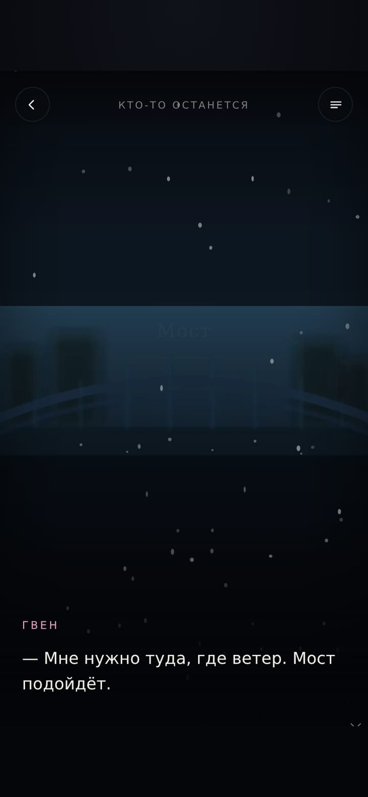
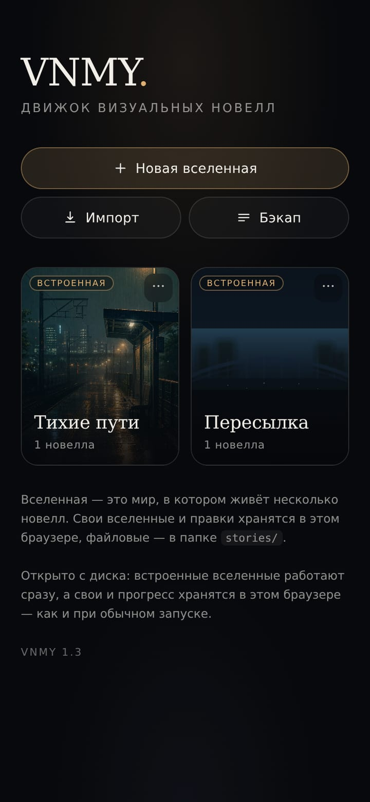
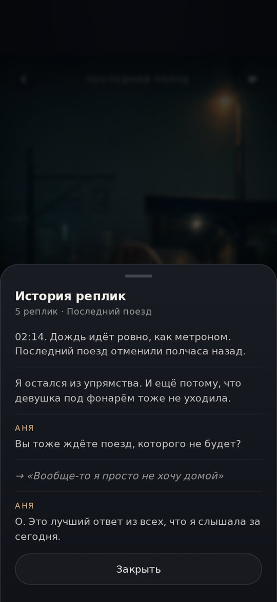
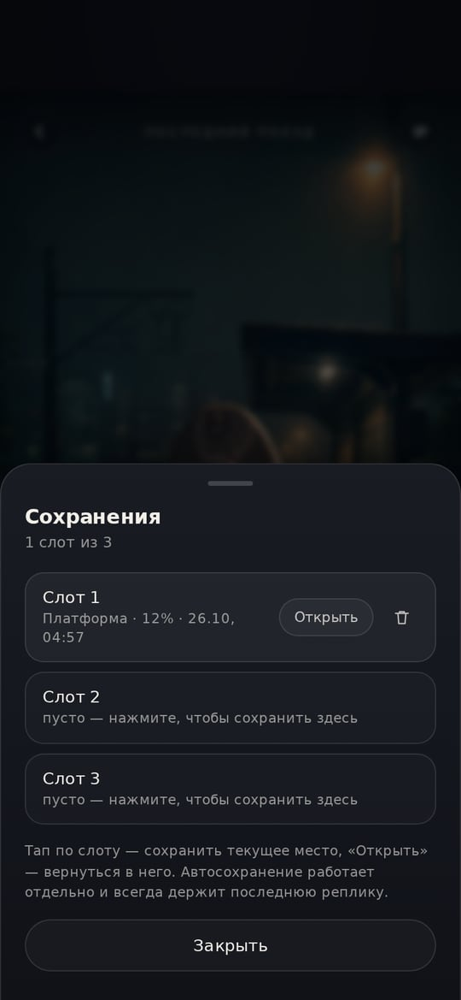
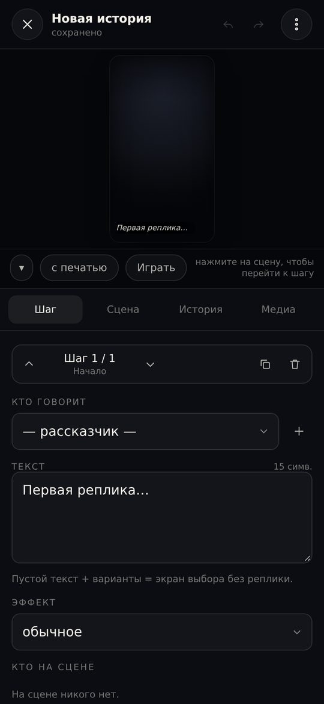
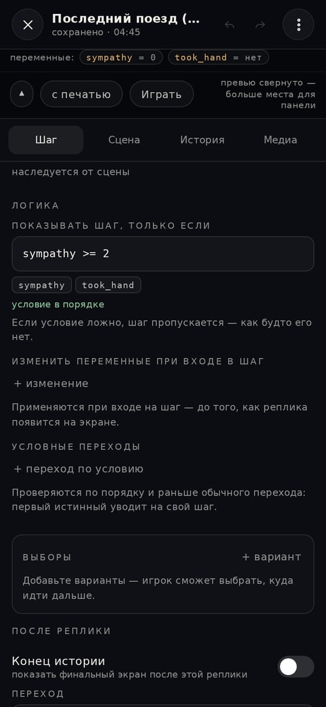
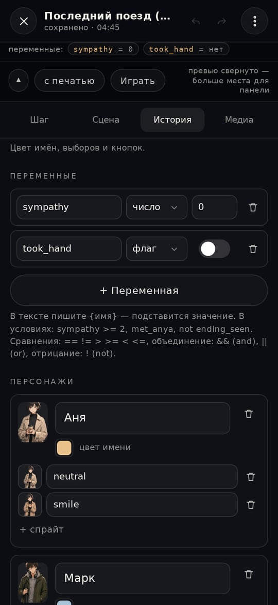
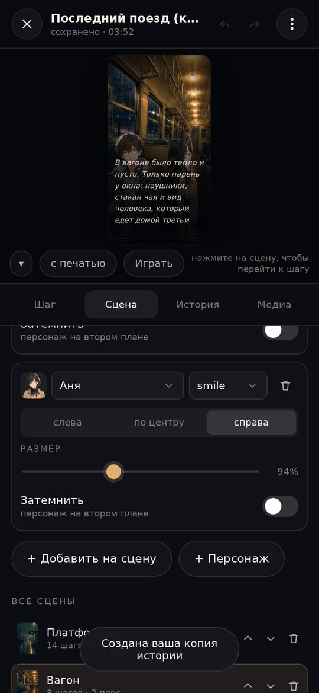

# VNMY 1.0

Движок визуальных новелл **в вертикальном формате** для игры в браузере на телефоне.
Без зависимостей и без сборки для игры: папка со статикой и ваши истории в JSON.
Открывается двойным щелчком по `index.html` — сервер не обязателен.

```
VNMY/
├── index.html              ← единственная страница: библиотека → игра → редактор
├── bundle.js               ← собранный движок для открытия с диска (npm run build)
├── start.sh                ← локальный сервер одной командой
├── tools/build.mjs         ← сборка bundle.js и stories/builtin.js
├── css/                    ← стили (база, плеер, редактор)
├── js/                     ← движок, формат, хранилище, редактор (исходники)
├── stories/                ← ВАШИ ИСТОРИИ (по папке на историю)
│   ├── index.json          ← список встроенных историй
│   ├── builtin.js          ← те же истории для открытия с диска (npm run build)
│   ├── demo/               ← демо «Последний поезд»
│   └── _template/          ← заготовка для новой истории
├── assets/                 ← иконки PWA
├── CHANGELOG.md            ← что нового по версиям
├── docs/format.md          ← полный справочник по формату story.json
└── manifest.webmanifest
```

**Версия 1.0** · [что нового](CHANGELOG.md)

<p>
  
  
  
  
  
  
  
  
</p>

---

## Запуск

### Просто двойной щелчок (без сервера)

Откройте `index.html` — всё работает прямо с диска: демо играется, редактор
сохраняет правки в браузере, экспорт скачивает файлы.

Почему так можно: браузеры не грузят ES-модули и не дают `fetch()` читать файлы
с `file://`, поэтому рядом лежат два заранее собранных обычных скрипта —
`bundle.js` (весь движок) и `stories/builtin.js` (встроенные истории).
Картинки грузятся относительными путями, поэтому папка `stories/` должна лежать рядом.

### Через сервер (удобнее для правок в `js/`)

```bash
./start.sh            # или: python3 -m http.server 8000
# открыть http://localhost:8000
```

Так страница работает на исходных ES-модулях из `js/`.

> После правок в `js/` или `stories/*.json` пересоберите файлы для диска:
> `npm run build`. Забыть не даст `npm test`: он проверяет, что `bundle.js`
> и `stories/builtin.js` совпадают с исходниками.

**Чтобы играть на телефоне**, папку нужно опубликовать (это обычная статика):

- **GitHub Pages** — залейте репозиторий, Settings → Pages → ветка `main`, папка `/root`.
- **Netlify Drop** — перетащите папку на app.netlify.com/drop, ссылка готова сразу.
- **Любой хостинг** — достаточно скопировать файлы.

Дальше на телефоне: открыть ссылку → «Поделиться» → «На экран Домой».
Приложение запустится без адресной строки, в вертикальной ориентации.

---

## Как выглядит игра

- вертикальная сцена 9:16 (`min(100vw, 100dvh·9/16)`) — на телефоне во весь экран,
  на компьютере по центру с рамкой;
- тап в любом месте: дописать реплику → следующая; выборы появляются поверх сцены;
- плавная смена фона, появление/уход спрайтов, дождь / снег / пыль / лепестки на canvas,
  эффекты: тряска, вспышка, наплыв, затемнение, смущение;
- **автоподбор размера текста** — длинная реплика уменьшается, чтобы влезть целиком;
- тап по самой реплике тоже листает (кроме случая, когда игрок выделяет текст);
- пауза перед репликой (`pause` в шаге) — «вдох» перед важной фразой;
- **переменные и условия**: флаги и счётчики («взял за руку», симпатия), скрытые реплики,
  варианты и переходы по условию, подстановка `{sympathy}` в текст без `eval`;
- прогресс сохраняется сам; в библиотеке видно «продолжить · 62%»;
- **журнал реплик** — всё прочитанное вместе с выбранными вариантами, в меню;
- **три ручных слота** сохранений: тап по слоту — сохранить, «Открыть» — вернуться,
  удалить можно там же; в сохранение едут переменные и журнал;
- **«меньше анимации»** в меню (по умолчанию повторяет системную настройку):
  без печати текста, дождя и переходов;
- после финала история открывается с начала, прогресс помечается как «прочитано»;
- меню: журнал реплик, сохранения, скорость и размер текста, пропуск прочитанного,
  «не гасить экран», «меньше анимации»;
- свайп/кнопка «назад» на телефоне возвращает в библиотеку.

---

## Как добавить историю

### Вариант А — файлами (для публикации)

1. Скопируйте `stories/_template` → `stories/моя-история`.
2. Положите картинки в `stories/моя-история/assets/`.
3. Отредактируйте `story.json` (вручную или экспортом из редактора).
4. Добавьте имя папки в `stories/index.json`:

```json
{ "stories": ["demo", "моя-история"] }
```

### Вариант Б — прямо в браузере

«Новая история» → редактор → экспорт. Всё, что создано в браузере, живёт в
`localStorage` этого устройства (≈5 МБ на всё), поэтому есть три уровня сохранности:

- **автосохранение** каждой правки (в том числе при сворачивании и закрытии вкладки);
- **«Экспорт с картинками»** — один самодостаточный JSON: картинки вшиты внутрь,
  такой файл открывается на любом устройстве без папки `stories/`;
- **«Бэкап»** в библиотеке — все ваши истории одним файлом; импорт понимает его обратно.

В библиотеке видно, сколько места уже занято, а при переполнении движок честно скажет,
что не влезло, вместо тихой потери данных.

> Встроенные истории из `stories/` доступны **только для чтения**: при попытке
> редактирования движок делает вашу копию, оригинал не меняется.

### Минимальный `story.json`

```json
{
  "title": "Моя история",
  "author": "Я",
  "cover": "assets/cover.webp",
  "accent": "#e0b072",
  "vars": [{ "name": "sympathy", "type": "number", "initial": 0 }],
  "characters": [
    { "id": "anya", "name": "Аня", "color": "#e8c08a",
      "sprites": { "neutral": "assets/anya.webp", "smile": "assets/anya-smile.webp" } }
  ],
  "scenes": [
    {
      "id": "sc1", "name": "Платформа",
      "bg": "assets/bg.webp", "weather": "rain",
      "cast": [{ "char": "anya", "sprite": "neutral", "pos": "center" }],
      "steps": [
        { "id": "t1", "speaker": null, "text": "Ночь. Дождь." },
        { "id": "t2", "speaker": "anya", "text": "Вы тоже ждёте поезд?" },
        { "id": "t3", "text": "", "choices": [
            { "text": "«Да»", "goto": "sc1:t4" },
            { "text": "«Нет»", "goto": "sc1:t5" }
        ]},
        { "id": "t4", "speaker": "anya", "text": "Тогда нам по пути.",
          "set": [{ "var": "sympathy", "op": "add", "value": 1 }], "goto": "sc1:t6" },
        { "id": "t5", "speaker": "anya", "text": "Жаль.", "end": true },
        { "id": "t6", "speaker": "anya", "if": "sympathy >= 1",
          "text": "Я так и знала, что вы согласитесь.", "endTitle": "КОНЕЦ · {sympathy}", "end": true }
      ]
    }
  ]
}
```

Всё остальное описано в **[docs/format.md](docs/format.md)**: эмоции, позиции,
эффекты, погода, переходы (`goto`), смена фона и состава по ходу сцены,
а также **переменные и условия** (`vars`, `if`, `set`, `gotoIf`, `choices[].if`,
`{подстановка}`).

---

## Встроенный редактор

| Вкладка | Что делает |
|---|---|
| **Шаг** | говорящий, текст (`*курсив*`, `**жирный**`, Enter), эмоция, эффект, кто на сцене с этого шага (появился / ушёл / сдвинулся), варианты выбора, переход, конец истории, блок «Логика»: условие показа, изменения переменных, условные переходы, условие у каждого варианта |
| **Сцена** | название, фон, погода, состав (позиция, размер, затемнение), порядок сцен, создание и удаление |
| **История** | название, автор, описание, язык, обложка, акцентный цвет, персонажи и их спрайты, переменные истории (имя, тип, начальное значение), проверка ссылок, статистика, экспорт |
| **Медиа** | все картинки истории, загрузка с устройства (сжимаются и вшиваются в историю), список путей |

- **живое превью** сверху: тап по превью = показать шаг, «Играть» = полное прохождение;
- превью сворачивается кнопкой ▾, если нужен экран побольше;
- **undo / redo** — кнопки в шапке и `⌘/Ctrl+Z`;
- автосохранение в браузер, статус в шапке («сохранено · 12:30»);
- **подсказки при вводе условий**: поле условия проверяет синтаксис на месте,
  называет необъявленные переменные и подставляет их имена по клику;
- **живые переменные в превью**: под превью видно текущие значения, они обновляются при листании;
- **проверка ссылок**: пустые варианты, переходы «в никуда», сцены без фона,
  конфликт «конец истории + варианты выбора», сломанные условия, `{опечатки}` в тексте,
  `set` по необъявленной переменной.

Путь к картинке считается от папки истории: `assets/bg.webp` →
`stories/моя-история/assets/bg.webp`. Можно вписать внешний URL или загрузить файл —
он сожмётся в WebP и сохранится внутри истории (удобно для переносимого JSON).

---

## Ассеты

| Что | Размер | Формат |
|---|---|---|
| Фон | 1080×1920 (9:16) | WebP/JPEG, ≤250 КБ |
| Спрайт | высота ~1500 px | **WebP/PNG с прозрачностью** |
| Обложка | 9:14 | WebP/JPEG |

Спрайт стоит низом к низу сцены и занимает 64% высоты — оставляйте «воздух» над
головой. Позицию и масштаб можно поправить в редакторе.

Конвертация одной командой (без установки чего-либо в проект):

```bash
npx sharp-cli -i hero.png -o stories/моя-история/assets/hero-neutral.webp --format webp -q 92
```

Фоны удобно гнать так: `npx sharp-cli -i bg.png -o bg.webp resize 1080 1920 --fit cover --format webp -q 80`.

---

## Управление (компьютер)

| Клавиша | Действие |
|---|---|
| `Space` / `Enter` / `→` | дальше / дописать реплику |
| `Esc` | меню (в игре) |
| `⌘/Ctrl + Z`, `⇧⌘/Ctrl + Z` | отменить / повторить (в редакторе) |

---

## Тесты

```bash
npm install   # только devDependencies: esbuild + jsdom
npm test
```

33 интеграционные проверки в jsdom: прохождение демо с ветвлением, сохранения
(автосейв и слоты), журнал реплик, редактор (правки, undo/redo, выборы, импорт/бэкап,
битые файлы), переменные и условия, режим «меньше анимации», а также запуск
с диска (`file://`) и свежесть `bundle.js` / `stories/builtin.js`.
Само приложение при этом остаётся без зависимостей — `js/` не импортирует ничего
из `node_modules`.

## Что внутри

| Файл | Роль |
|---|---|
| `js/engine.js` | сцена: фон, спрайты, печать текста, выборы, переходы, эффекты |
| `js/format.js` | схема истории, нормализация, резолвер переходов, линтер |
| `js/weather.js` | canvas-слой погоды |
| `js/store.js` | localStorage: истории, сохранения, настройки, импорт/экспорт |
| `js/library.js` | библиотека историй |
| `js/player.js` | прохождение: сохранения, меню, wake lock |
| `js/editor*.js` | редактор (каркас, вкладки, контролы) |
| `js/ui.js`, `js/util.js` | шторки, тосты, диалоги, утилиты |
| `sw.js` | офлайн-режим: приложение открывается без сети |
| `tests/run.mjs` | интеграционные проверки (`npm test`) |

Звука пока нет — это самая заметная точка расширения
(`Stage.renderInstance` + поле `audio` в шаге).

---

## Совместимость

- Chrome/Edge 111+, Safari 16.4+, Firefox 128+ (container queries, `dvh`);
- данные редактора — в `localStorage` (≈5 МБ). Для больших проектов держите картинки
  файлами в `stories/<имя>/assets`, а не загружайте в историю;
- PWA-манифест и service worker: приложение открывается без сети. HTML/JS/CSS
  загружаются по принципу network-first, поэтому новые версии подхватываются сразу,
  а офлайн работает последняя загруженная; картинки — cache-first.
